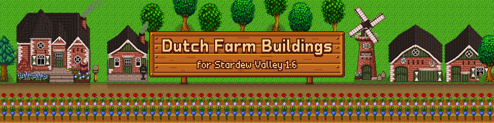
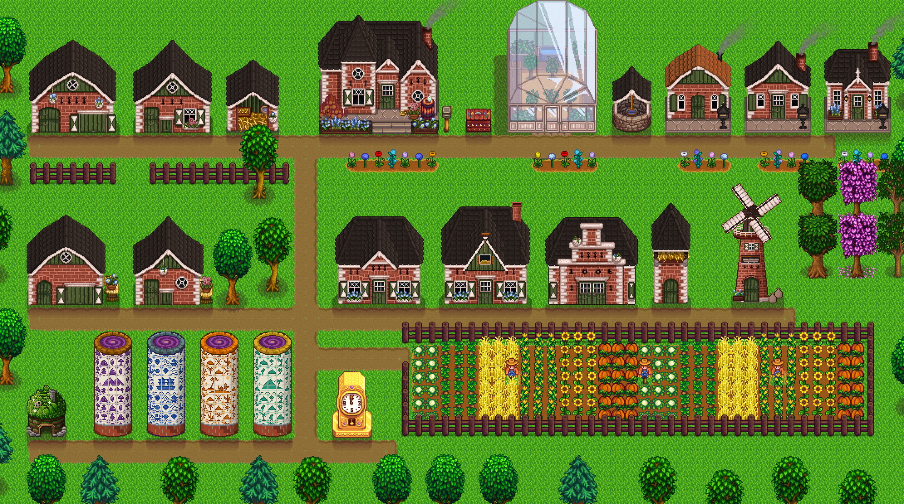
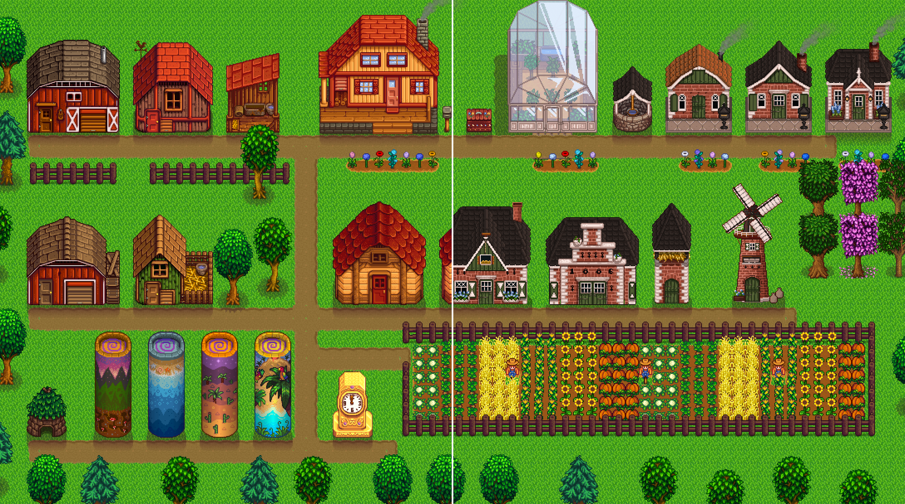
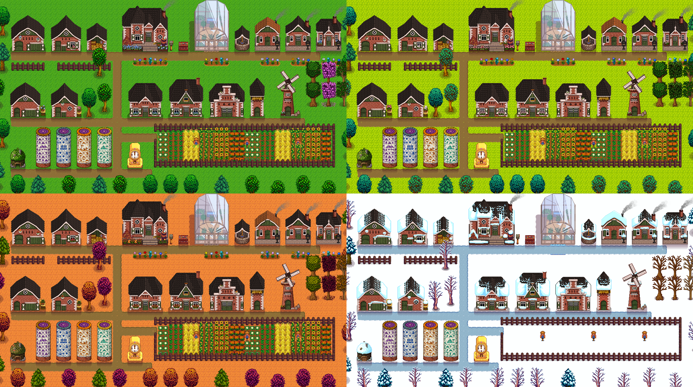
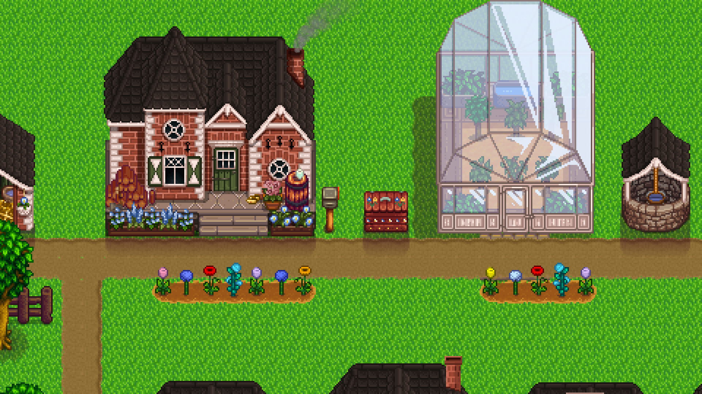
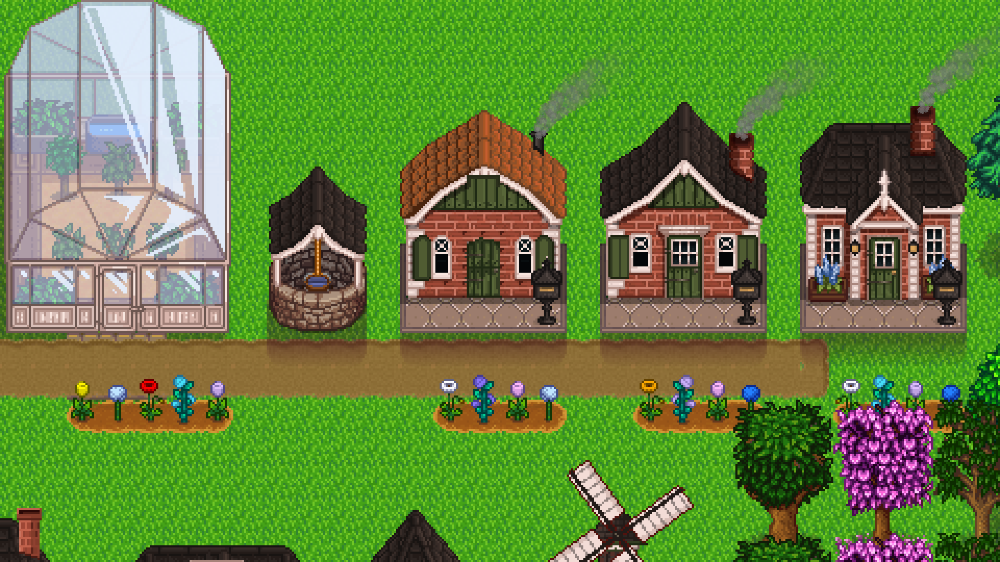
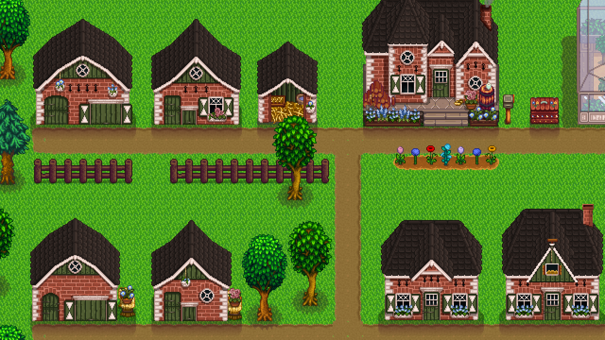
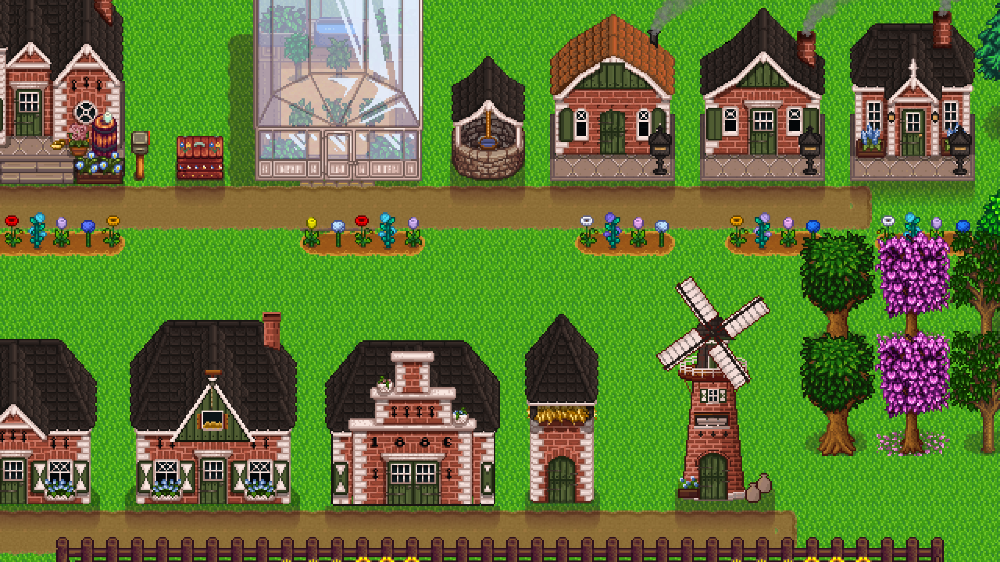
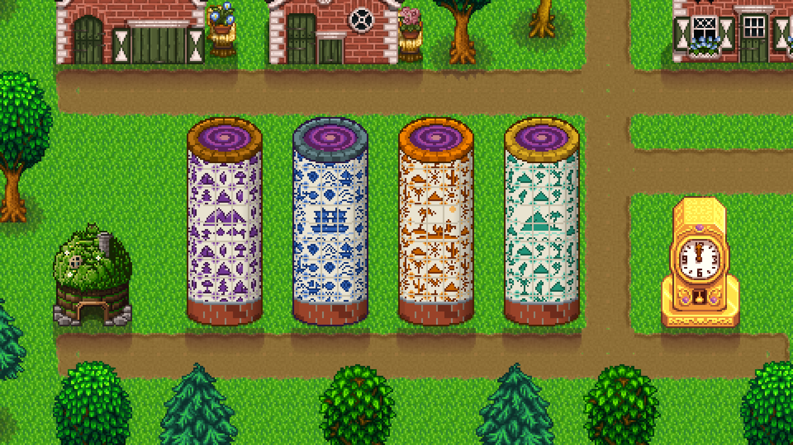
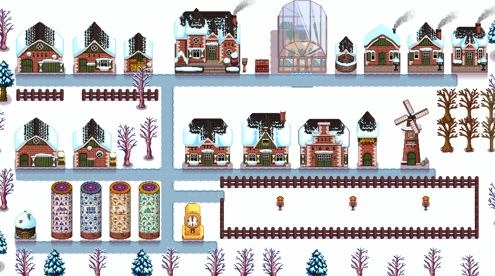

# Dutch Farm Buildings

Dutch farm buildings for Stardew Valley 1.6, as a Content Patcher pack. It's a remake of [eemie's Dutch Farm Buildings](https://www.moddrop.com/stardew-valley/mods/811243), which stopped working properly with 1.6, with [Cazanna's matching cabins](https://www.nexusmods.com/stardewvalley/mods/5758) merged in and a few new buildings in the same style.

**Download: [Nexus Mods](https://www.nexusmods.com/stardewvalley/mods/54257)**

## What's in it

- Barns, coops, shed, silo, stable, well and the Tractor Mod garage
- The farmhouse, with a pair of klompen on the porch, and the greenhouse
- Log, plank and stone cabins with their own look at each upgrade stage
- New: a Big Shed, a windmill with turning sails, a Slime Hutch and a Winery look for it, a Junimo hut shaped like a Drenthe plaggenhut, Delft-tiled obelisks, a Hindeloopen shipping bin and a Gold Clock with a pendulum window
- Spring, summer, fall and winter textures; Ginger Island stays summer
- English and Dutch

With [Generic Mod Config Menu](https://www.nexusmods.com/stardewvalley/mods/5098) you pick whether the Dutch buildings replace the vanilla ones or show up as skins at Robin's, and you can turn every group of buildings off on its own.

## Screenshots

| | |
|---|---|
|  |  |
| Vanilla on the left, Dutch on the right | All four seasons |
|  |  |
| The farmhouse | A cabin at each upgrade stage |
|  |  |
| Barns and coops | The windmill |
|  |  |
| Junimo plaggenhut, Delft obelisks, Gold Clock | Winter |

## Install

1. Install [SMAPI](https://www.nexusmods.com/stardewvalley/mods/2400) and [Content Patcher](https://www.nexusmods.com/stardewvalley/mods/1915) 2.9 or newer.
2. Download the mod from [Nexus](https://www.nexusmods.com/stardewvalley/mods/54257) and unzip it into your `Mods` folder.

The `mod/` folder here is the same pack as the Nexus download.

Playing in Dutch? The building names match [my Dutch translation of Stardew Valley](https://www.nexusmods.com/stardewvalley/mods/54211).

## Credits

Most of the art is from these people. I put it together for 1.6 and made the new buildings from their parts and palettes.

- **eemiestardew**, for the original [Dutch Farm Buildings](https://www.moddrop.com/stardew-valley/mods/811243)
- **ChefRude**, for the winter snow on eemie's buildings
- **Cazanna**, for the [Unofficial Seasonal Cabins](https://www.nexusmods.com/stardewvalley/mods/5758)
- **Magimatica**, for the greenhouse from [Hudson Valley Buildings](https://www.nexusmods.com/stardewvalley/mods/1478)
- **ConcernedApe**, for Stardew Valley; the shipping bin, Gold Clock and parts of the Junimo hut start from his sprites

## Permissions

Don't re-upload this mod to other sites. You may use my own additions in your mods with credit; for everything else, follow the permissions of the original authors listed above.
